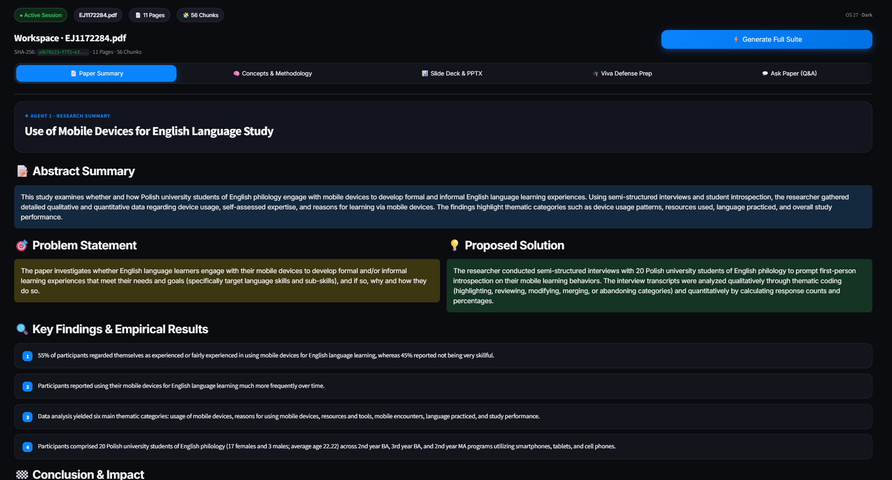
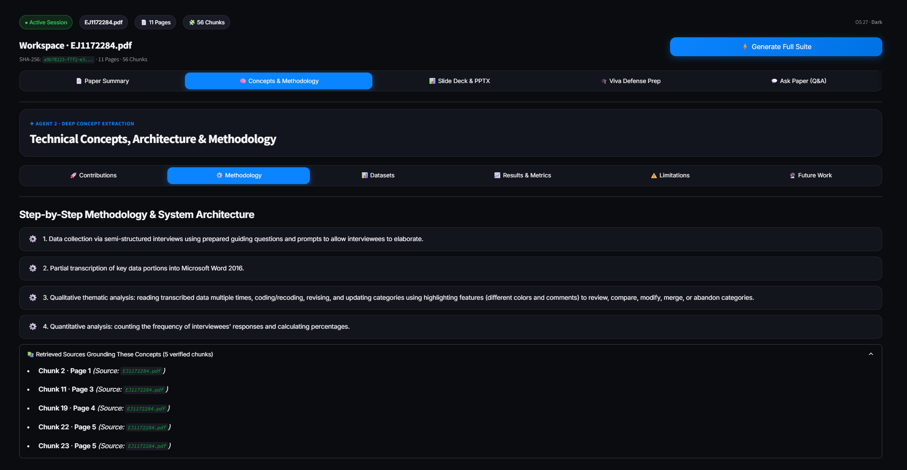
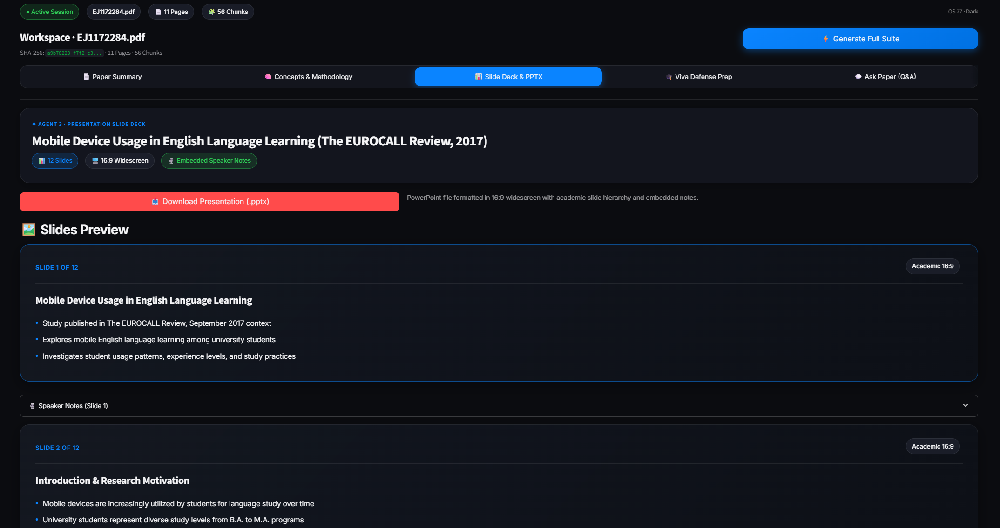
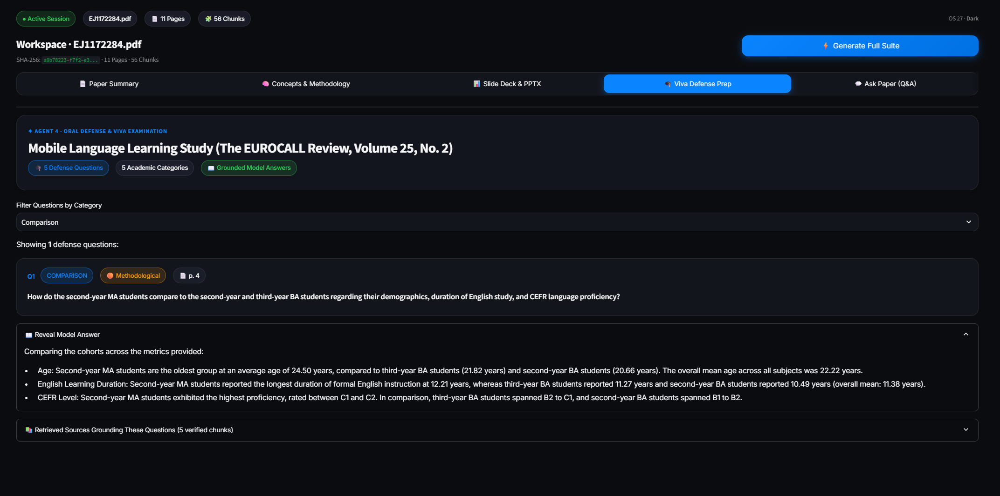
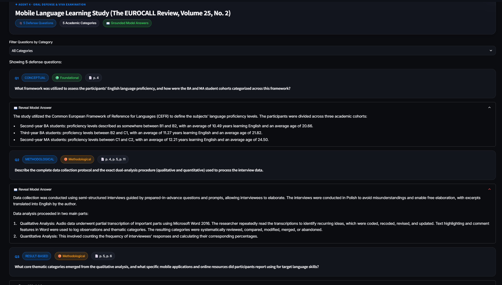
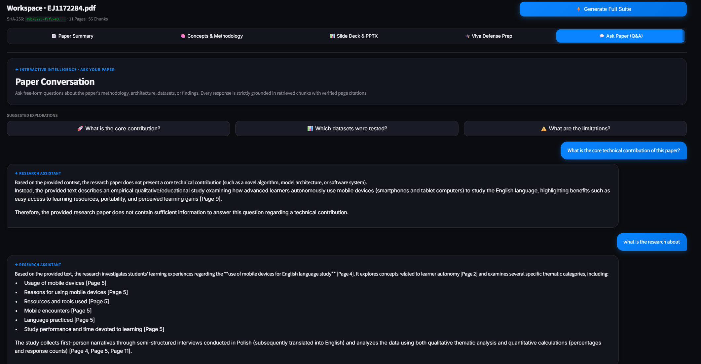

# Paper-to-Presentation & Viva Agent

An autonomous multi-agent AI research assistant that transforms academic research papers (PDF) into structured executive summaries, deep technical concept breakdowns, formatted 16:9 PowerPoint presentations (`.pptx`), oral defense (viva) Q&A examinations, and citation-grounded conversational Q&A.

**Repository:** [https://github.com/HiteshNreddy/paper-to-presentation-viva-agent](https://github.com/HiteshNreddy/paper-to-presentation-viva-agent)

---

## 📖 Project Overview

Reading dense academic literature and preparing seminar slides or viva defense answers takes hours of manual synthesis. **Paper-to-Presentation & Viva Agent** automates this workflow using a modular LangChain (LCEL) and Retrieval-Augmented Generation (RAG) architecture:

1. **Defense-in-Depth PDF Ingestion**: Validates PDF magic bytes, rejects empty, corrupted, encrypted, or image-only PDFs, extracts text page-by-page using **PyMuPDF (`fitz`)**, and chunks each page individually so every chunk retains deterministic 1-based page attribution.
2. **Session-Scoped Vector Isolation**: Generates a full-content SHA-256 document ID (`doc_id`), computes normalized 384-dimensional vectors locally using **Sentence Transformers (`all-MiniLM-L6-v2`)**, and stores them in persistent **ChromaDB** filtered strictly by `{"doc_id": {"$eq": doc_id}}`.
3. **Agentic RAG Gatekeeping**: Combines semantic similarity with lexical keyword overlap reranking (`RAGPipeline`), triggers fallback refinement when relevance is sparse, refuses ungrounded queries (`InsufficientContextError`), and enforces explicit `[Page X]` attribution.
4. **Four Specialized Agents + PPTX Builder**: Orchestrates dedicated Pydantic-validated agents for summarization, concept extraction, slide generation (exported in memory via `python-pptx`), and viva preparation, wrapped in an adaptive Dark/Light Streamlit interface.

---

## ✨ Key Features

| Capability | Description |
|---|---|
| **📄 Paper Summarisation** | Structured summary with Title, Abstract Summary, Problem Statement, Proposed Solution, Key Findings & Empirical Results, Conclusion, and verified chunk sources. |
| **🧠 Technical Concept Extraction** | Breakdown across 6 academic dimensions: *Contributions*, *Methodology*, *Datasets*, *Results & Metrics*, *Limitations*, and *Future Work*. |
| **📊 16:9 Slide Deck & PPTX Export** | Generates 10–12 structured slides with concise bullet points, embedded presenter speaker notes, and instant in-memory `.pptx` download via `python-pptx`. |
| **🎓 Viva Defense Preparation** | Generates probing oral examination questions across 5 academic categories (*Conceptual*, *Methodological*, *Result-Based*, *Critical*, *Comparison*) with category filtering, difficulty indicators, verified per-question `source_pages`, and expandable model answers. |
| **💬 Interactive Paper Q&A** | Chat interface with suggested exploration chips, grounded `[Page X]` citations, and explicit refusal when the paper lacks supporting evidence. |
| **🔒 Multi-Session Document Isolation** | Content-addressed `doc_id` metadata filtering prevents cross-session chunk leakage and skips duplicate re-ingestion automatically. |
| **⚡ Quota-Aware Gemini Client** | Configured with REST transport, 30-second finite request timeouts, dynamic `.env` loading, and immediate halt logic (`DailyQuotaExceededError`) on HTTP 429 daily quota exhaustion. |
| **🎨 Adaptive Apple-Inspired Workspace** | Translucent glassmorphic Streamlit UI (`ui/styles.py`) featuring a real-time Dark / Light mode toggle and 16:9 slide preview cards. |

---

## 🏗️ System Architecture

```text
                    +-------------------------------------------------------+
                    |   Streamlit Frontend (app.py, ui/styles.py)           |
                    |   [ui/sidebar.py: Upload, Theme Toggle, Doc Status]   |
                    |   [ui/result_views.py: Tabs, 16:9 Cards, Chat UI]     |
                    +---------------------------+---------------------------+
                                                |
                   +----------------------------+----------------------------+
                   | Direct Agent Dispatch / Intent Router                   |
                   | (agents/router.py: detect_intent, dispatch)             |
                   +----------------------------+----------------------------+
                                                |
      +--------------------+--------------------+--------------------+--------------------+
      v                    v                    v                    v                    v
Summarizer          Concept Extractor    Slide Generator       Viva Agent         Interactive Q&A
(summarizer.py)     (concept_extractor)  (slide_generator)     (viva_agent.py)    (RAGPipeline.ask)
      |                    |                    |                    |                    |
      +--------------------+--------------------+--------------------+--------------------+
                                                |
                                                v
                    +-------------------------------------------------------+
                    |   RAG Retrieval & Grounding Hub                       |
                    |   - core/rag_context.py (Relevance & Fallback Gate)   |
                    |   - core/rag_pipeline.py (Hybrid Reranking + Citation)|
                    +---------------------------+---------------------------+
                                                |
          +-------------------------------------+-------------------------------------+
          v                                                                           v
+------------------------------------------+             +------------------------------------------+
| Ingestion & Vector Store (Local)         |             | LLM & Structured Output Layer            |
| - core/pdf_loader.py (PyMuPDF validation)|             | - core/llm.py (AppChatGoogleGenerativeAI)|
| - core/text_splitter.py (Page-level)     |             |   REST transport, 30s timeout, 429 Guard |
| - core/embeddings.py (all-MiniLM-L6-v2)  |             | - config/settings.py (python-dotenv)     |
| - core/vector_store.py (ChromaDB doc_id) |             | - schemas/*.py (Pydantic validation)     |
+------------------------------------------+             +--------------------+---------------------+
                                                                              |
                                                                              v
                                                         +------------------------------------------+
                                                         | utils/pptx_builder.py (python-pptx)      |
                                                         | 13.33" x 7.50" (16:9) + Speaker Notes    |
                                                         +------------------------------------------+
```

---

## 🗂️ Project Structure

```text
paper-to-presentation-agent/
├── app.py                          # Streamlit application entry point
├── LICENSE                         # MIT License (Copyright (c) 2026 HiteshNreddy)
├── README.md                       # Project documentation
├── requirements.txt                # Pinned/constrained Python dependencies
├── pytest.ini                      # Pytest testpaths configuration
├── .env.example                    # Environment variables template (placeholders only)
├── .gitignore                      # Excludes .env, .venv, chroma_store, uploads, outputs
│
├── agents/                         # Four specialized LCEL agents & intent router
│   ├── concept_extractor.py        # Agent 2: Technical concept extraction
│   ├── router.py                   # Intent classification & agent dispatch
│   ├── slide_generator.py          # Agent 3: Presentation slide deck generation
│   ├── summarizer.py               # Agent 1: Structured paper summarization
│   └── viva_agent.py               # Agent 4: Viva defense Q&A generation & page pruning
│
├── config/
│   └── settings.py                 # Central settings singleton & dynamic .env loader
│
├── core/                           # Ingestion, Embeddings, Vector Store, LLM, and RAG
│   ├── embeddings.py               # Local Sentence Transformers (all-MiniLM-L6-v2) singleton
│   ├── llm.py                      # Quota-aware Gemini client (REST, 30s timeout, HTTP 429 guard)
│   ├── pdf_loader.py               # PyMuPDF validation & 1-based page extraction
│   ├── pdf_pipeline.py             # Validation -> extraction -> SHA-256 doc_id -> chunking
│   ├── rag_context.py              # Retrieval decision logic & relevance assessment
│   ├── rag_pipeline.py             # Hybrid RAG pipeline & grounded Q&A chain
│   ├── text_splitter.py            # Page-level RecursiveCharacterTextSplitter
│   └── vector_store.py             # Persistent ChromaDB wrapper with doc_id isolation
│
├── docs/                           # Documentation artifacts committed for review
│   ├── presentations/              # Sample exported PowerPoint presentation (.pptx)
│   └── screenshots/                # Verified UI screenshots from application execution
│
├── prompts/                        # System prompt templates for the four agents
├── schemas/                        # Pydantic output & attribution schemas
├── scripts/                        # Connectivity diagnostic, failure checks & offline demos
├── tests/                          # Automated test suite (18 test files, 209 tests)
│   └── data/
│       └── sample_research_paper.pdf
│
├── ui/                             # Streamlit UI modules
│   ├── result_views.py             # Summary, Concepts, Slides, Viva, and RAG Chat views
│   ├── sidebar.py                  # PDF upload, theme toggle, active doc card, reset
│   └── styles.py                   # Adaptive Dark / Light glassmorphic CSS system
│
└── utils/
    ├── doc_id.py                   # Full-file SHA-256 UUID generator
    ├── file_utils.py               # PDF magic-byte validation & safe directory helpers
    └── pptx_builder.py             # 16:9 widescreen python-pptx generator with speaker notes
```

---

## 🛠️ Installation (Windows / PowerShell)

1. **Clone the repository:**
   ```powershell
   git clone https://github.com/HiteshNreddy/paper-to-presentation-viva-agent.git
   cd paper-to-presentation-viva-agent
   ```

2. **Create and activate a Python 3.11+ virtual environment:**
   ```powershell
   python -m venv .venv
   .\.venv\Scripts\Activate.ps1
   ```

3. **Install dependencies:**
   ```powershell
   pip install -r requirements.txt
   ```

---

## ⚙️ Configuration

Configuration is managed centrally in [`config/settings.py`](config/settings.py) and loaded from the project-root `.env` file via `python-dotenv` (`override=True` in normal execution so `.env` overrides stale system environment variables, while preserving test fixture isolation during `pytest`).

1. **Create `.env` from `.env.example`:**
   ```powershell
   Copy-Item .env.example .env
   ```

2. **Configure your Gemini API key and settings in `.env` (never commit `.env` to Git):**
   ```ini
   GOOGLE_API_KEY=your_google_gemini_api_key_here
   GEMINI_MODEL=gemini-3.8-flash
   GEMINI_TRANSPORT=rest
   GEMINI_REQUEST_TIMEOUT=30.0
   EMBEDDING_MODEL=all-MiniLM-L6-v2
   CHROMA_PERSIST_DIR=./chroma_store
   CHROMA_COLLECTION_NAME=paper_chunks
   RAG_TOP_K=5
   CHUNK_SIZE=1000
   CHUNK_OVERLAP=200
   LLM_MAX_RETRIES=2
   ```

### Gemini Client Configuration & Resilience (`config/settings.py` & `core/llm.py`)
- **Default Gemini Model**: Configured by default as `gemini-3.8-flash` (`os.getenv("GEMINI_MODEL", "gemini-3.8-flash")`). Changing `GEMINI_MODEL` in `.env` automatically refreshes the cached client in `get_llm()`.
- **REST Transport (`GEMINI_TRANSPORT=rest`)**: `AppChatGoogleGenerativeAI` initializes `ChatGoogleGenerativeAI` with `transport="rest"` (HTTPS over port 443), avoiding gRPC connection hangs encountered on some Windows environments.
- **30-Second Request Timeout (`GEMINI_REQUEST_TIMEOUT=30.0`)**: `AppChatGoogleGenerativeAI._generate()` explicitly forwards `timeout=30.0` seconds on every `generate_content` call so stalled network requests fail cleanly rather than hanging indefinitely.
- **API Key Safety & Validation**: Missing keys or the default placeholder (`your_google_gemini_api_key_here`) raise an explicit `RuntimeError`. Diagnostic logging and connectivity probes never print or expose raw API keys.
- **Daily Quota Handling (`DailyQuotaExceededError`)**: `is_daily_quota_error()` inspects HTTP 429 `RESOURCE_EXHAUSTED` exceptions for daily Free Tier quota indicators (`requests per day`, `free_tier_requests`, `generaterequestsperday`). When detected, retries are halted immediately, the retry delay is extracted via `parse_quota_retry_delay()`, and a clear warning banner explains when the user can retry or upgrade billing.

---

## 🚀 Usage Workflow

### Launch the Streamlit Application
```powershell
.\.venv\Scripts\streamlit.exe run app.py
```
Open **`http://localhost:8501`** in your browser.

### Step-by-Step Workflow
1. **Upload Research Paper**: Upload a text-based PDF in the left sidebar. The pipeline validates `%PDF` magic bytes and encryption status, extracts page-numbered text, creates overlapping chunks, computes the SHA-256 `doc_id`, and indexes 384-dimensional embeddings into ChromaDB.
2. **Inspect Active Document & Theme**: The sidebar displays document metadata (*Pages*, *Chunks*, *Size in KB*, and truncated SHA-256 *doc_id*) plus a **Light / Dark** appearance switch and active runtime specs.
3. **Run Agents**:
   - Click **⚡ Generate Full Suite** in the top workspace bar to execute all four agents sequentially with live progress tracking, **or**
   - Generate outputs individually inside each workspace tab.
4. **Export Presentation**: Preview all 16:9 slide cards and expandable speaker notes under **📊 Slide Deck & PPTX**, then click **📥 Download Presentation (.pptx)**.
5. **Practice Viva & Ask Questions**: Filter questions by examination category in **🎓 Viva Defense Prep**, or explore follow-up questions with source page citations in **💬 Ask Paper (Q&A)**.

---

## 📸 Screenshots

The screenshots below capture the redesigned Streamlit workspace processing an 11-page academic PDF (`EJ1172284.pdf`, 56 chunks).

### Application Dashboard
Active session workspace showing document status pills, `⚡ Generate Full Suite` workflow, and the sidebar PDF upload panel with Light/Dark appearance control, active document card, and runtime architecture specs.




### Paper Analysis
Agent 1 (*Paper Summary*) presenting the structured Abstract Summary, Problem Statement, Proposed Solution, and numbered Key Findings; and Agent 2 (*Concepts & Methodology*) organizing extracted methodology and retrieved chunk traceability across 6 tabs.




### Presentation Generation
Agent 3 (*Slide Deck & PPTX*) rendering 16:9 widescreen preview cards, collapsible speaker notes, and the in-memory `.pptx` download action.



### Viva Preparation and Paper Q&A
Agent 4 (*Viva Defense Prep*) supporting category filtering (*All Categories* or specific exam categories) with difficulty badges, source page pills, and expandable model answers; alongside the grounded *Ask Paper (Q&A)* interface showing strict out-of-scope refusal and `[Page X]` citations.







---

## 📊 Sample Generated Presentation

A real PowerPoint deck generated by the application from the uploaded research paper (*"Mobile Device Usage in English Language Learning (The EUROCALL Review, 2017)"*, `EJ1172284.pdf`) is included in the repository:

- **Download / View Sample PPTX:** [`docs/presentations/Mobile_Device_Usage_in_English_Language_Learning_T.pptx`](docs/presentations/Mobile_Device_Usage_in_English_Language_Learning_T.pptx)
- **Verified Structure**: `12` slides (`13.33" x 7.50"` 16:9 widescreen format, `59.81 KB`) with academic formatting, footer progress counters, and embedded presenter speaker notes on all `12` slides.

---

## 🧪 Testing & Verification

### Automated Test Suite (Offline / Mocked LLM)
The full `pytest` suite runs **offline without making live Gemini API requests**. Agent chains and RAG generation tests use deterministic `RunnableLambda` LLM mocks (`tests/conftest.py` and per-test mocks), while PDF extraction, chunking, SHA-256 hashing, local `all-MiniLM-L6-v2` embeddings, ChromaDB isolation, PPTX binary generation, and Streamlit view rendering execute against real code paths:

```powershell
.\.venv\Scripts\pytest.exe -v
```

Latest verified run: **`209 passed`** across **`18` test files** (`0` failed, `0` skipped, `7` third-party/environment warnings).

### Offline Integration & Error-Handling Scripts
```powershell
# Verify module imports, PDF ingestion, mocked slide generation, and real PPTX export
.\.venv\Scripts\python.exe scripts/verify_phase6.py

# Verify missing API key RuntimeError and sanitized invalid-key failure handling
.\.venv\Scripts\python.exe scripts/verify_failure_handling.py
```

### Live Gemini API Connectivity Check (Consumes 1 Live API Request)
To confirm live Gemini API connectivity, REST transport, and active quota with your `.env` key:
```powershell
.\.venv\Scripts\python.exe scripts/test_gemini_connection.py
```

---

## ⚠️ Limitations & Scope Notes

- **Mocked Tests vs. Live API Verification**: The `209` `pytest` tests validate pipeline logic, Pydantic schemas, RAG filtering, quota-guard handling, PPTX output, and UI view functions using mocked LLMs (`RunnableLambda`). Live Gemini API behavior depends on your active API key, network access, and Google AI Studio quota; sample live outputs on `EJ1172284.pdf` are preserved in `docs/screenshots/` and `docs/presentations/`.
- **Gemini Free Tier Quota**: Google AI Studio Free Tier keys enforce strict daily request limits (for example, 20 requests/day per model bucket, and Google's backend may alias preview/model buckets). When daily quota is exhausted, `core/llm.py` raises `DailyQuotaExceededError` immediately without useless retries and reports the retry wait window in the UI.
- **Text-Based PDFs Only**: Text extraction uses PyMuPDF (`fitz`). Scanned or image-only PDFs without an embedded text layer cannot be extracted without external OCR and are rejected cleanly during validation.
- **Intent Classification Helper**: `agents/router.py` exposes `detect_intent()` and `dispatch()`. The Streamlit UI invokes `router.dispatch()` directly per selected tab and routes free-form chat directly to `RAGPipeline.ask()`, both of which propagate `DailyQuotaExceededError` explicitly.

---

## 📄 License

This project is licensed under the **MIT License** — see the [`LICENSE`](LICENSE) file for full details.
